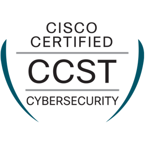
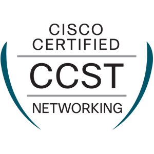
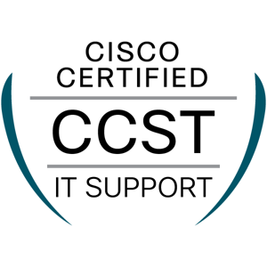
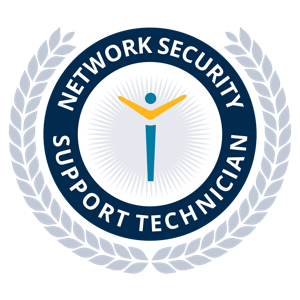
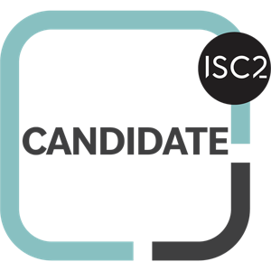

# Hi, I'm Sam 👋

**Samual A. Michael** — IT Help Desk Support • Cybersecurity & Network Engineering student
🎯 **Goal: Cloud Security Engineer**

I support hundreds of student and staff devices (Active Directory, Microsoft 365, Ivanti Neurons, imaging) and build an enterprise home lab to practice what I learn.

🌐 [samyord.com](https://samyord.com) • 💼 [LinkedIn](https://www.linkedin.com/in/samual-a-michael/) • 📄 [Resume](https://samyord.com/Degree_and_Certifications_PDF/Samual_A_Michael_Resume.pdf)

---

## 🎓 Education
**Saint Paul College**

| Credential | Status |
|---|---|
| Certificate — Network & System Administration | ✅ Awarded May 2026 |
| A.A.S. Cybersecurity | 📘 Expected May 2027 |
| A.A.S. Network Engineering | 📘 Expected May 2027 |

## 🏅 Certifications
*Click a badge to verify it on Credly.*

| Certification | Issued | Verify |
|---|---|---|
| Cisco CCST Cybersecurity | 2026 | [Credly](https://www.credly.com/badges/74512d2c-2295-42d0-89b9-6c6a829872ae/public_url) |
| Cisco CCST Networking | 2025 | [Credly](https://www.credly.com/badges/85aa9d6a-fcfb-477a-999f-25d93e9adc7e/public_url) |
| Cisco CCST IT Support | 2025 | [Credly](https://www.credly.com/badges/cb02c7fd-f2e4-4b6b-af3c-797d9eb3feb2/public_url) |
| Network Security Support Technician | — | [Credly](https://www.credly.com/badges/49d84934-568a-4391-a0a4-4d6a242b43a4/public_url) |
| ISC2 Candidate | — | [Credly](https://www.credly.com/badges/96b7f821-5d16-47d7-bcfc-77b883a31ded/public_url) |
| AWS Skill Builder | — | [AWS Skills Profile](https://skillsprofile.skillbuilder.aws/user/SAMAWS) |

## ☁️ Road to Cloud Security Engineer

| Step | Certification / skill | Status |
|---|---|---|
| 1 | Cisco CCST ×3 — IT support, networking, security basics | ✅ Done |
| 2 | CCNA 200-301 — routing, switching, network security | 📘 Studying |
| 3 | ISC2 CC → CompTIA Security+ — security fundamentals | 🎯 Next |
| 4 | AWS Certified Cloud Practitioner — cloud basics | 🎯 Planned |
| 5 | AWS Solutions Architect – Associate — build secure cloud networks | 🎯 Planned |
| 6 | AWS Security – Specialty / Microsoft AZ-500 — cloud security | 🎯 Goal |

**Hands-on next:** extend SAM.LAB into AWS — VPC design, site-to-site VPN from pfSense to AWS, IAM least privilege, CloudTrail + GuardDuty logging, and infrastructure as code.

## 🔧 Projects

| Project | What it shows |
|---|---|
| **[SAM.LAB — Enterprise Home Lab](https://github.com/SAM857SAM/SAM.LAB)** | pfSense, IPsec VPN, DMZ, Active Directory, GPO, Hyper-V, Guacamole + Cloudflare Zero Trust, Autopsy forensics — 16 step-by-step guides |
| **Student Support Kiosk** | Python / Tkinter self-service touchscreen app |
| **Multilingual Video Guides** | ~45–50 how-to videos in 7 languages for students |
| **Technology Orientation Knowledge Base** | Help-desk KB for new students (TeamDynamix) |
| **Armstrong Homes website** | Website build for an assisted-living business |

## 🛠 Skills
**Security & Systems:** Active Directory • Group Policy • Windows Server 2022 • Linux • BitLocker • Ivanti Neurons • Autopsy • Wireshark
**Networking:** pfSense • IPsec/IKEv2 VPN • DMZ • DHCP/DNS • TCP/IP • Cisco Packet Tracer
**Cloud & Zero Trust:** Cloudflare Tunnel + Access • AWS (learning)
**Support:** Microsoft 365 • TeamDynamix • imaging/deployment • VMware • Hyper-V
**Scripting:** PowerShell • Python • HTML
